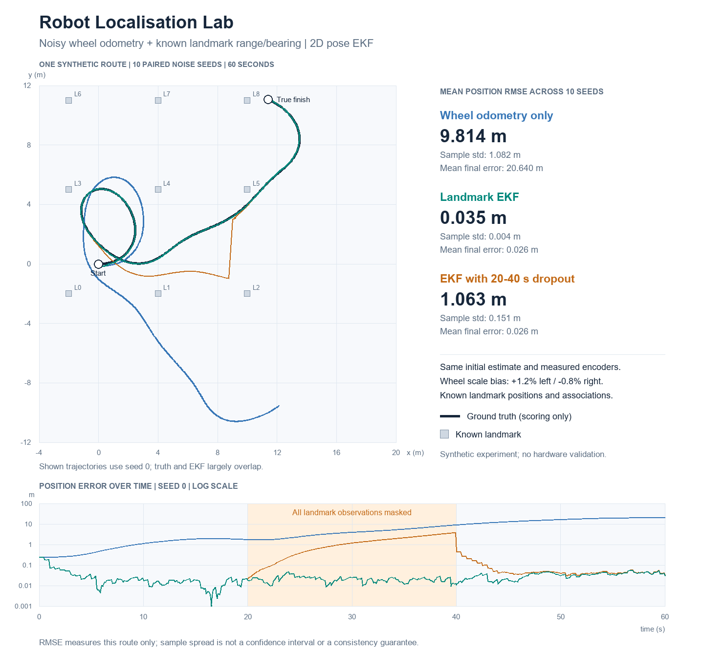

# Robot Localisation Lab

A compact Python experiment in **mobile-robot state estimation**: combine imperfect wheel odometry with noisy range/bearing observations of known landmarks using an Extended Kalman Filter (EKF).

The question is concrete: how much does a landmark correction reduce pose drift, and what happens when every landmark observation disappears for 20 seconds? All comparisons use the same trajectory, initial estimate and measured encoder data. The experiment is synthetic and uses no robot hardware, ROS or external dataset.



## Reproduce

Use Python **3.10 or newer**. From this directory:

```bash
python -m pip install -r requirements.txt
python -m unittest discover -p "test_*.py" -v
python demo.py
```

`demo.py` writes the checked-in `metrics.json`, `demo.png` and `demo.svg` alongside the code. Choose another destination with `python demo.py --output my-results`.

The recorded run used **Python 3.12.14, NumPy 2.3.5 and Pillow 12.3.0**. Numeric metrics are deterministic with the same dependencies and platform; tiny floating-point differences can occur elsewhere. Font rendering may vary. No training, internet connection or GPU is required.

## Actual ten-seed results

Each trial lasts 60 simulated seconds: 600 wheel increments at 10 Hz, with landmark observations every fifth increment. Seeds **0 through 9** change sensor noise, not the route. The table reports the mean of ten per-trial scores; the spread is the **sample standard deviation across those seeds**, not a confidence interval.

| Estimator | Mean trajectory position RMSE | Sample std of RMSE | Mean final position error |
|---|---:|---:|---:|
| Wheel odometry only | 9.813761 m | 1.081925 m | 20.640333 m |
| EKF with available landmarks | 0.035075 m | 0.003836 m | 0.025563 m |
| EKF with all landmarks masked from 20 to 40 s | 1.063236 m | 0.151271 m | 0.026075 m |

The baseline deliberately includes persistent wheel-scale errors: **+1.2% on the left wheel and -0.8% on the right**. A differential error accumulates into a large heading error and then position drift. This strong result is conditional on that drift model and on frequent, correctly associated landmark observations; it is not a general robotics accuracy claim.

The dropout EKF accumulates drift while observations are missing and corrects its pose when they return. Its small final error does not erase the large errors earlier in that interval. Correction jumps in the estimated trajectory are changes in the estimate, not jumps in the simulated physical robot.

All per-seed position RMSE, final errors, heading RMSE, update counts and minimum covariance eigenvalues are in [metrics.json](metrics.json). For a run with `N+1` poses:

```text
position RMSE = sqrt(mean((estimated_x - true_x)^2 + (estimated_y - true_y)^2))
final error   = distance between the final estimated and true positions
```

The initial pose is included in RMSE. The figure shows **seed 0**, rather than a selected best run, and a logarithmic position-error axis. Errors below 0.001 m are clipped only in the plot; scoring uses the original values.

## Data and fair comparison

- The true initial pose is `[0, 0, 0]`. Every estimator starts at `[0.20 m, -0.15 m, 0.08 rad]`, with covariance `diag(0.30², 0.30², 0.12²)`.
- The true trajectory follows a deterministic varying forward/yaw-rate schedule. Ground truth and prediction share a **midpoint discrete differential-drive model**. This is a chosen discrete model, not exact integration of a continuous circular arc.
- Measured wheel travel has the fixed scale errors above plus independent Gaussian noise of **0.002 m standard deviation per wheel per step**. The EKF assumes **0.003 m**; it does not know or estimate the wheel biases.
- Nine landmarks have exactly known positions and identities. The idealised sensor covers **360 degrees** and ranges **0.5-7.0 m**, with independent Gaussian noise of **0.08 m** in range and **2 degrees** in bearing. There is no occlusion or association ambiguity.
- Independent seeded random streams generate wheel and landmark noise. Each dataset is generated once. The normal EKF, odometry ablation and dropout EKF reuse it; dropout masks observations in **[20 s, 40 s)** after generation. It cannot change the noise samples elsewhere.
- `PoseEKF` takes only a prior, wheel increments, a range/bearing measurement and a known landmark. The experiment runner does not read `dataset.truth` while estimating. Truth is used for synthetic sensor generation, scoring and display. A test changes every truth pose and confirms identical estimator output.

## EKF implementation

The state is `[x, y, heading]`. Distances are metres; headings and bearing innovations are radians wrapped to `[-pi, pi)`.

For wheel travel `d_left`, `d_right` and wheel separation `L`:

```text
distance = (d_left + d_right) / 2
turn = (d_right - d_left) / L
mid_heading = heading + turn / 2

x_next = x + distance * cos(mid_heading)
y_next = y + distance * sin(mid_heading)
heading_next = wrap(heading + turn)
```

`motion_and_jacobians` returns the prediction and analytical derivatives with respect to both state and wheel increments. The wheel covariance is propagated through the control Jacobian:

```text
P_predicted = F @ P @ F.T + G @ Q_wheel @ G.T
```

For a landmark at `(landmark_x, landmark_y)`, the observation model is:

```text
dx = landmark_x - x
dy = landmark_y - y
range = sqrt(dx*dx + dy*dy)
bearing = wrap(atan2(dy, dx) - heading)
```

The observation Jacobian is analytical. Each observation is applied sequentially, with a freshly evaluated Jacobian and a wrapped bearing residual. The Kalman gain uses a linear solve instead of an explicit matrix inverse. Covariance uses the **Joseph update** and is symmetrised against floating-point asymmetry:

```text
A = I - K @ H
P_corrected = A @ P_predicted @ A.T + K @ R @ K.T
```

The code rejects malformed/non-finite vectors, nonpositive wheel separation, invalid covariance shapes, nonsymmetric/negative covariances, nonpositive measurement noise covariance, nonpositive measured ranges and undefined bearing geometry within 0.000001 m of a landmark. A failed innovation-covariance factorisation is reported explicitly. There is no outlier gate; the generator does not introduce outliers.

## Tests

Run `python -m unittest discover -p "test_*.py" -v`. The **11 tests** verify:

- analytical motion/control and observation Jacobians against central finite differences, including a bearing branch boundary;
- a small wrapped innovation when equivalent bearings straddle `-pi` and `pi`;
- finite states and symmetric positive-semidefinite covariance through normal and dropout runs;
- invalid input and singular landmark-geometry rejection;
- an exact observation preserving the mean while reducing uncertainty;
- identical odometry results when landmark updates are disabled or absent;
- truth-independence of estimation and deterministic noise generation;
- a paired landmark benefit on three fixed seeds;
- dropout affecting only its interval, covariance growth, returning observations and recovery.

All 11 tests and the full ten-seed demo were run locally. This statement does not imply a GitHub CI result.

## Limits

This is a pose EKF with a known landmark map, **not SLAM**. Landmark location and identity are treated as exact. The simulation omits slip events, timestamp errors, latency, occlusion, false associations, dynamic landmarks, correlated sensor errors and non-Gaussian outliers. The EKF's local linearisation can fail for large prior errors or ambiguous geometry.

The bias is unmodelled, so Gaussian zero-mean assumptions are already imperfect. The covariance is the filter's internal uncertainty estimate; positive-semidefinite matrices and low RMSE do **not** establish calibrated confidence, statistical consistency or optimality. No NEES/NIS consistency study is claimed. Ten noise seeds on one route do not measure generalisation across maps, trajectories or real sensors.

Next experiments could estimate wheel bias, evaluate additional trajectories, perturb the landmark map, add outliers with a tested gate, or compare an unscented filter. These are future work, not implemented features.

## Interview prompts

- Why does wheel-scale mismatch create heading drift even on a straight segment?
- How do `F` and `G` differ, and why does wheel noise need the `G Q G.T` term?
- Why must bearing innovations be wrapped before applying the gain?
- What becomes singular when a landmark sits on the estimated robot position?
- Why use a Joseph covariance update and a linear solve?
- Why can the dropout experiment finish accurately while having a poor trajectory RMSE?
- How would you assess whether the covariance is statistically consistent?

Further reading: [Carnegie Mellon's Extended Kalman Filter lecture notes](https://www.cs.cmu.edu/~16385/s17/Slides/16.4_Extended_Kalman_Filter.pdf). This is a teaching reference, not a claim that this repository reproduces that course's implementation or results.

## Files and provenance

The repository is deliberately flat: `localization.py`, `demo.py`, `test_localization.py`, `README.md`, `requirements.txt`, `LICENSE`, `.gitignore`, `metrics.json`, `demo.png` and `demo.svg`.

Initial code, tests, documentation and figures were prepared **with AI assistance for Nishanth Senthil Kumar's learning portfolio**. The repository is an educational implementation and a base for code review, reproduction and further experiments. It does not establish independent implementation experience, mastery, professional delivery or hardware robotics experience.

MIT licensed. All measurements come from the included synthetic generator; no personal data, external dataset, API key or paid service is needed.
